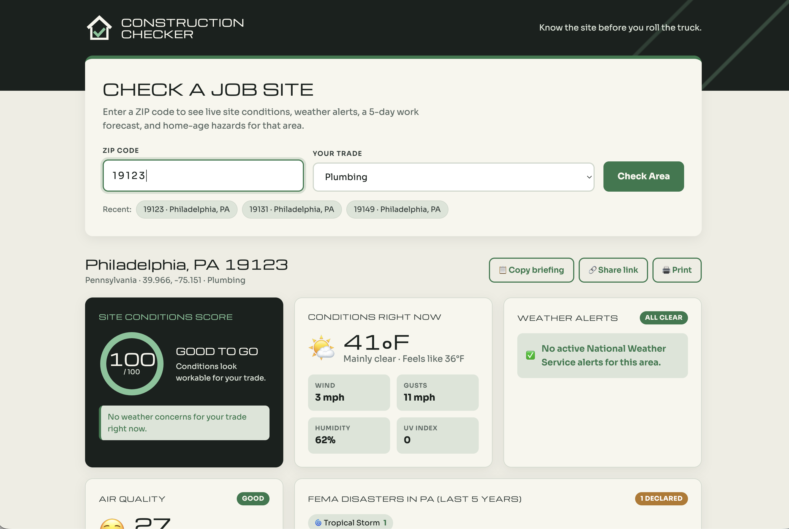

# 🏗️ Construction Checker

A front-end app for people in the trades (construction, roofing, HVAC, plumbing, electrical, and painting). Enter a ZIP code before a job to see live site conditions, weather alerts, a 5-day work forecast, and home-age hazards for that area, all scored for **your** trade.

🔗 **Live Demo:** [kareemahb.github.io/api-construction](https://kareemahb.github.io/api-construction/)



## ✨ Features

- **ZIP code search**: enter a 5-digit ZIP code and click **Check Area**. The field only accepts numbers.
- **Trade profiles**: pick General Construction, Roofing, HVAC, Plumbing, Electrical, or Painting. Each trade has its own limits for heat, cold, wind, and rain (roofers get stricter wind limits, painters need 50°F+, and so on).
- **Site Conditions Score (0–100)**: an animated gauge with a verdict (**Good to go**, **Use caution**, or **Hold outdoor work**) and a list of what to watch for.
- **Conditions right now**: temperature, feels-like, wind, gusts, humidity, and UV index.
- **Live weather alerts** from the National Weather Service, with instructions you can expand.
- **Air quality**: the U.S. Air Quality Index plus PM2.5, PM10, and ozone. Unhealthy air lowers the site score.
- **FEMA disaster history**: federal disaster declarations in the state over the last 5 years, grouped by type (storms, floods, hurricanes, and so on).
- **Home Age & Hazards**: the median year homes in the ZIP code were built and the share built before 1980, with a checklist for lead paint, asbestos, old wiring, and old pipes.
- **5-Day Work Planner**: each day is rated for your trade, so you can schedule outdoor work on the best days.
- **Trade safety tips** for the selected trade.
- **Copy job briefing**: copies a plain-text summary to paste into a crew group chat.
- **Shareable links**: the URL updates to `?zip=19104&trade=roofing`, so a link opens the same report.
- **Print-friendly report** for the job folder.
- **Recent searches**: your last 5 ZIP codes appear as one-click chips, and your trade is remembered.
- **Error handling**: clear messages for invalid or unknown ZIP codes. If one data source is down, the other cards still load.
- **Responsive design** for phones on the job site.

## 🔌 APIs Used

All free, and none of them need an API key.

| API                                                                                       | What it provides                                     |
| ----------------------------------------------------------------------------------------- | ---------------------------------------------------- |
| [Zippopotam.us](https://www.zippopotam.us/)                                               | Turns a ZIP code into a city, state, and coordinates |
| [Open-Meteo](https://open-meteo.com/)                                                     | Current weather and the 5-day forecast               |
| [National Weather Service](https://www.weather.gov/documentation/services-web-api)        | Active weather alerts for the location               |
| [U.S. Census Bureau ACS](https://www.census.gov/data/developers/data-sets/acs-5year.html) | Year homes were built in each ZIP code               |
| [Open-Meteo Air Quality](https://open-meteo.com/en/docs/air-quality-api)                  | Current air quality index and pollutants             |
| [OpenFEMA](https://www.fema.gov/about/openfema/api)                                       | Disaster declarations by state                       |

## 🔍 How It Works

```
ZIP code ──▶ Zippopotam (city + coordinates)
                 │
                 ├──▶ Open-Meteo ──────▶ conditions, score, 5-day planner
                 ├──▶ Weather.gov ─────▶ alerts
                 ├──▶ Census ACS ──────▶ home age & hazards
                 ├──▶ Open-Meteo AQ ───▶ air quality
                 └──▶ OpenFEMA ────────▶ disaster history
```

After the ZIP lookup, the other requests run at the same time with `Promise.allSettled()`, so one slow or broken API doesn't block the rest.

### How the score is calculated

Every location starts at **100**, and points come off for:

| Condition                                     | Points off                    |
| --------------------------------------------- | ----------------------------- |
| Thunderstorms                                 | 35                            |
| Extreme heat or cold (past the trade's limit) | 25–30                         |
| Strong wind gusts (past the trade's limit)    | 12–30                         |
| Rain                                          | 15–40, depending on the trade |
| Snow or ice                                   | 20                            |
| Active weather alert                          | 10, or 30 if severe           |
| Air quality index over 100                    | 10–35                         |
| High UV or humidity (painting)                | 5–10                          |

**75+** is Good to go, **50–74** is Use caution, and **below 50** is Hold outdoor work.

## 🧱 Code Structure

`main.js` uses one class per API, plus the main app class:

| Class                  | Job                                                                           |
| ---------------------- | ----------------------------------------------------------------------------- |
| `ZipLookupAPI`         | Gets the city, state, and coordinates for a ZIP code                          |
| `WeatherAPI`           | Gets current conditions and the 5-day forecast                                |
| `AlertsAPI`            | Gets active National Weather Service alerts                                   |
| `HousingAPI`           | Gets home-age data from the Census and calculates the share built before 1980 |
| `AirQualityAPI`        | Gets the current air quality index and pollutants                             |
| `DisasterAPI`          | Gets FEMA disaster declarations for the state and removes duplicates          |
| `ConstructionCheckApp` | Handles the form, scoring, rendering, recent searches, and sharing            |

Trade limits and tips live in the `TRADES` object, so adding a new trade is a few lines of config.

## 🎨 Design

| Color | Hex       |
| ----- | --------- |
| Ink   | `#121C17` |
| Slate | `#2E3B37` |
| Green | `#2C7A4B` |
| Sage  | `#DCE5D9` |
| Cream | `#F7F6EE` |
| Mint  | `#7FC79A` |

Fonts: [Michroma](https://fonts.google.com/specimen/Michroma) for headings and [Sora](https://fonts.google.com/specimen/Sora) for body text.

## 🛠️ Tech Stack

- HTML5
- CSS3 (custom properties, Grid, Flexbox, animations, print styles)
- JavaScript (ES6 classes, `async`/`await`, Fetch API, `Promise.allSettled`, `localStorage`, Clipboard API)
  No frameworks, dependencies, or build tools.

## 📁 Project Structure

```
api-construction/
├── index.html   # Header, ZIP code + trade form, results section
├── main.css     # Styling and color palette
└── main.js      # API classes, scoring, and ConstructionCheckApp
```

## 🚀 Getting Started

Try it live on **[GitHub Pages](https://kareemahb.github.io/api-construction/)**, or run it locally:

```bash
git clone https://github.com/kareemahb/api-construction.git
cd api-construction
```

Open `index.html` with the **Live Server** extension in VS Code.

## ⚠️ Disclaimer

Construction Checker is a planning tool. Always follow OSHA rules, your employer's safety plan, and what you see on site.

## 👩‍💻 Created By

**Kareemah Bahaadur**
[GitHub](https://github.com/kareemahb)
